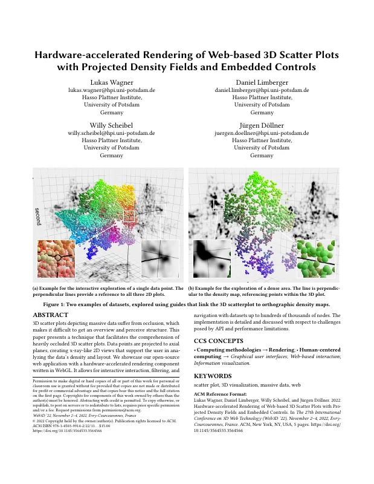
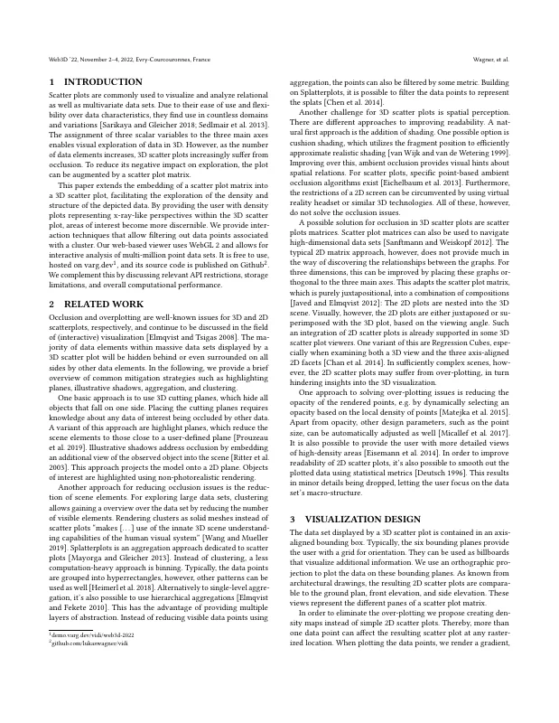
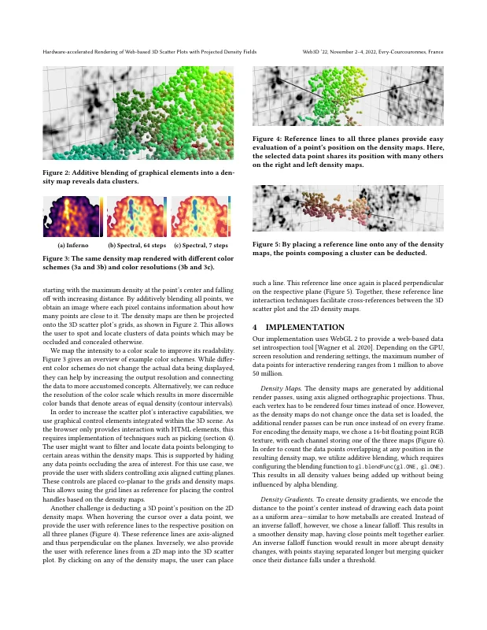
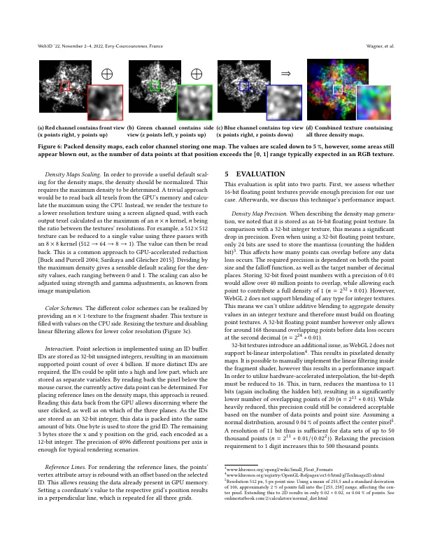
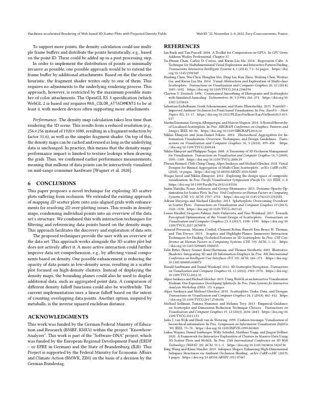

# Hardware-accelerated Rendering of Web-based 3D Scatter Plots with Projected Density Fields and Embedded Controls

[Lukas Wagner](https://orcid.org/0000-0002-5934-3310), [Daniel Limberger](https://orcid.org/0000-0002-9111-4809), [Willy Scheibel](https://orcid.org/0000-0002-7885-9857), and [Jürgen Döllner](https://orcid.org/0000-0002-8981-8583)

*Proceedings of the 27th International Conference on 3D Web Technology (Web3D '22)*, November 2–4, 2022, Evry-Courcouronnes, France. ACM.

DOI: [10.1145/3564533.3564566](https://doi.org/10.1145/3564533.3564566) · Author's version: Zenodo *(pending)* · Best Paper Award ([Web3D awards](https://web3d.siggraph.org/awards/)) · Code: [lukaswagner/vidi](https://github.com/lukaswagner/vidi) · [Live demo](https://demo.varg.dev/vidi/web3d-2022)

> 3D scatter plots depicting massive data suffer from occlusion, which makes it difficult to get an overview and perceive structure.
> This paper presents a technique that facilitates the comprehension of heavily occluded 3D scatter plots.
> Data points are projected to axial planes, creating x-ray-like 2D views that support the user in analyzing the data's density and layout.
> We showcase our open-source web application with a hardware-accelerated rendering component written in WebGL.
> It allows for interactive interaction, filtering, and navigation with datasets up to hundreds of thousands of nodes.
> The implementation is detailed and discussed with respect to challenges posed by API and performance limitations.

<p><a href="wagner2022-scatter-plot-density-as-submitted.pdf"></a> <a href="wagner2022-scatter-plot-density-as-submitted.pdf"></a> <a href="wagner2022-scatter-plot-density-as-submitted.pdf"></a> <a href="wagner2022-scatter-plot-density-as-submitted.pdf"></a> <a href="wagner2022-scatter-plot-density-as-submitted.pdf"></a></p>

## Contents

- [`src/`](src/) – LaTeX sources of the camera-ready version (ACM `acmart`, sigconf); `src/figures/*.pdf` (+ `.md5`) are the TikZ-externalized figures as compiled on Overleaf
- [`wagner2022-scatter-plot-density-as-submitted.pdf`](wagner2022-scatter-plot-density-as-submitted.pdf) – camera-ready PDF (author build, identical to the PDF submitted to ACM)
- [`build.sh`](build.sh) – reproducible build with TeX Live 2022 (podman or docker)
- [`preview/`](preview/) – page previews for this README

## Build

```bash
./build.sh        # → build/main.pdf
```

The paper was compiled on Overleaf in September 2022 (pdfTeX 1.40.24, TeX Live 2022), hence the TeX Live 2022 container.
The build reproduces the camera-ready PDF pixel-identically (compared against the PDF distributed by ACM).
The TikZ figures (teaser, color maps, density fields) are taken from the externalized PDFs in `src/figures/`; to regenerate them, run `pdflatex -shell-escape` after deleting the respective `.pdf`/`.md5` files (the result differs by a few pixels).

## Versions

- [`v1.0-camera-ready`](https://github.com/dl-archive/article.2022-web3d-scatter-plot-density/tree/v1.0-camera-ready) – sources as submitted to ACM (2022-09-30)

## Citation

```bibtex
@InProceedings{wagner2022-scatter-plot-density,
  author    = {Wagner, Lukas and Limberger, Daniel and Scheibel, Willy and D{\"o}llner, J{\"u}rgen},
  title     = {Hardware-accelerated Rendering of Web-based 3D Scatter Plots with Projected Density Fields and Embedded Controls},
  booktitle = {Proceedings of the 27th International Conference on 3D Web Technology},
  year      = {2022},
  series    = {Web3D~'22},
  publisher = {ACM},
  doi       = {10.1145/3564533.3564566},
  isbn      = {978-1-450399-14-2},
}
```
